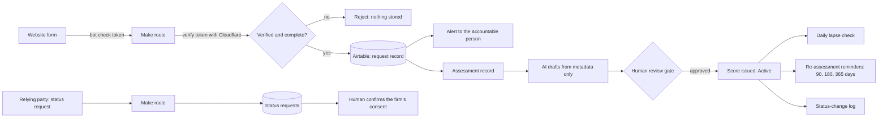

# Architecture

How a request, an assessment and a score move through the practice's systems. Booking, invitations and payments are shown in [integration-platform.md](integration-platform.md). The web forms run on Webflow, the routes on Make, and the records live in Airtable; email and alerts go through Microsoft 365 and Teams.

## Design rules

- **AI drafts, a person decides.** No score or finding reaches anyone without a named person's review.
- **Least privilege.** Connections to Microsoft 365 use scoped Microsoft Graph permissions with administrator consent.
- **Nothing trusted from the browser.** Every form is checked server-side for a valid bot-check token and complete fields before anything is stored. Rejected requests leave no record.
- **Every status change is logged.** The log records who changed what and why, and its rows are never edited.
- **Secrets stay in the platforms.** Keys live in Make and Cloudflare, never in page code or documents.
