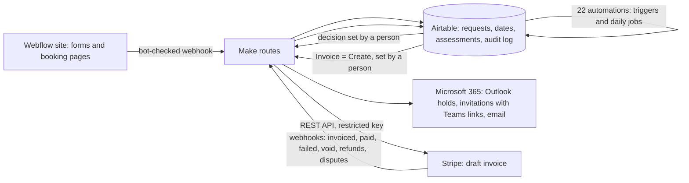

# Integration platform

The practice runs on five platforms joined by REST APIs and webhooks. Airtable is the system of record; Make carries data between systems; nothing reaches a client until a named person approves it.

## What runs where

| Layer | What it does |
|---|---|
| Webflow | Public site, request forms and booking pages. Forms carry a Cloudflare Turnstile token; nothing is trusted from the browser. |
| Make | Verifies tokens, writes requests, checks Outlook for calendar clashes, sends invitations and decline notices, drafts Stripe invoices, and receives Stripe webhooks. |
| Airtable | Records of requests, booking dates and times, assessments and every status change, plus 22 automations (below). |
| Microsoft 365 | Private calendar holds, Outlook invitations with Teams links, branded email, Teams alerts. |
| Stripe | Invoices and payments by card or bank (ACH). A restricted API key gives Make only the access it needs. |

## The 22 Airtable automations

| Group | Count | What they do |
|---|---|---|
| Audit trail | 10 | Write an audit-log row whenever a record is created in an operational table. |
| Score oversight | 2 | Daily lapse check at 6:00 am; log every score status change. |
| Booking holds | 4 | Hold the requested date or time; release holds that lapse unconfirmed (daily). |
| Booking decisions | 4 | Private calendar hold; send the owner's Confirm, Decline or Cancel; tell a requester a hold lapsed; 7:00 am reminder of unconfirmed holds. |
| Re-assessment | 1 | Daily reminder before each 90-, 180- and 365-day reading. |
| Billing | 1 | Draft a Stripe invoice when the owner sets Invoice = Create: price by lookup key or a fee override, automatic workshop credit, payment-timing rules, duplicate and missing-data guards. |

## Controls built into the flows

- **Human gates.** A booking is confirmed, declined or cancelled only when the owner sets the decision. An invoice is only drafted; the owner reviews it in Stripe and sends it.
- **Idempotency.** A decision cannot be sent twice, and an invoice cannot be drafted for a request that already has an open one.
- **Least privilege.** The Stripe key can write only invoices, customers, products, prices and webhook endpoints, and read only what the webhooks need. Balance access is off.
- **Money is moved only by a person.** Automations never issue refunds or transfers.
- **Everything is logged.** Each decision, status change and invoice writes an audit-log row.
